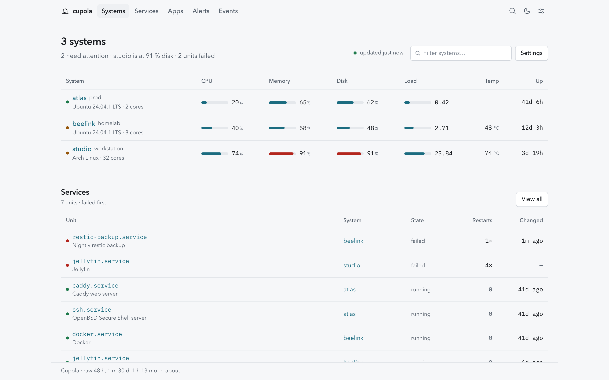

# Cupola

**A clear view of every machine you run.**

Cupola is self-hosted monitoring for Linux fleets: VPSes, homelab boxes, Raspberry
Pis and the machine under the desk. One small agent per host, one hub, and a
dense, fast PWA.

- **Fleet, node, process, service.** CPU, memory, disk, network, pressure,
  sensors, SMART, GPU, systemd units, containers, listening ports and
  processes in one place.
- **AI agent roster.** See which Codex, Claude Code, Cursor, Aider, OpenCode
  or model servers are running, for how long, and what they cost in CPU/RAM.
- **Clickable apps.** Wake a LAN machine with Wake-on-LAN or run a fixed local
  script from a phone.
- **Alerts that fit your stack.** Metric rules and event rules that POST to
  your own webhook; ntfy, Discord, Slack and Telegram too.
- **Zero-config for NATed hosts.** A hub with a public address is polled from,
  or agents report to it: no inbound port, no relay, no connection string.
- **Every view has a URL.** Copy and share a node, process, agent session,
  service, container, app, alert or event, with its time range intact.

> **Status: v1 shipped.** Agent, hub, PWA and deployment assets are in the tree.
> Start with [docs/DEPLOY.md](docs/DEPLOY.md); the API is in
> [docs/API.md](docs/API.md). Acceptance and known limits are in
> [docs/reports/ACCEPTANCE.md](docs/reports/ACCEPTANCE.md).

## Shape

```
   phone / browser ──HTTPS──▶ hub ──HTTP (pull)──▶ agents   LAN, same host, VPN
                              ▲
                              └──── HTTP (push) ── agents   NAT, CGNAT
```

| Role | Runs on | Does |
| --- | --- | --- |
| `cupola agent` | every monitored host | collects metrics, serves a read-only local API, runs configured actions |
| `cupola hub` | one box / VPS / homelab | pulls reachable agents, receives pushed samples, stores history, evaluates alerts, serves the PWA |
| `cupola serve` | one box | hub + embedded agent, for the single-server case |
| `cupola upgrade` | the hub box, as root | installs the release the hub queued: verifies checksums, swaps binary and PWA, restarts, rolls back on failure |

## Design

Data terminal: dark, dense, monochrome figures, colour only on data and status,
one 1 px accent line for selection. No cream-paper dashboards, gradients, glass,
emoji or icon chips. Agent marks come from Warren’s preset set. See
[docs/DESIGN.md](docs/DESIGN.md).

## Security

Read-only by default. Remote actions are fixed scripts or Wake-on-LAN packets
configured on the agent, never arbitrary shell. API tokens for automation are
scoped to read or a specific action allowlist. Webhooks are signed and guarded
against SSRF. No telemetry.

## Development

```bash
# all-in-one: hub + embedded agent on http://127.0.0.1:8080
CUPOLA_ADMIN_PASSWORD='a long password' go run ./cmd/cupola serve

# or separately
go run ./cmd/cupola agent --init --node atlas --name atlas --config /tmp/atlas.json
go run ./cmd/cupola agent --config /tmp/atlas.json
CUPOLA_ADMIN_PASSWORD='a long password' go run ./cmd/cupola hub --web-dir web/dist
```

Web development and tests:

```bash
cd web && npm ci
npm run dev          # http://localhost:5173 (needs a hub, see docs/DEPLOY.md)
npm run lint
npm test
npm run build        # production build and PWA in web/dist
npx playwright test  # starts a hub + three fictional agents (scripts/e2e-hub.sh)
```



The screenshot uses fictional nodes (`atlas`, `beelink`, `studio`).

Go checks:

```bash
go vet ./...
go test ./...
go build ./cmd/cupola
```

Fonts are self-hosted and there are no runtime third-party assets.

## License

MIT
